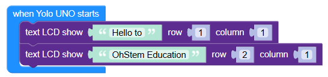
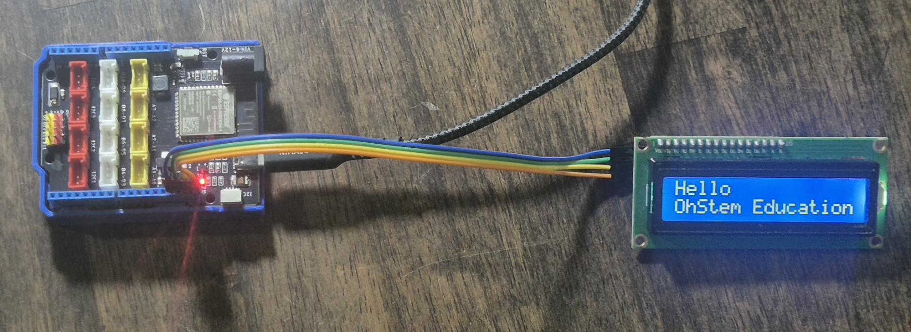

# Màn hình LCD1602

Viết tên dự án của em ở đây.

## 1. Ảnh chương trình Scratch



## 2. Mã nguồn Python

Viết mã nguồn Python của em ở đây.

```python
from lcd1602 import *
from yolo_uno import *

lcd1602 = LCD1602()

async def setup():

  print('App started')
  lcd1602.show(str('Hello'), 1 - 1, 1 - 1)
  lcd1602.show(str('OhStem Education'), 2 - 1, 1 - 1)

async def main():
  await setup()
  while True:
    await asleep_ms(100)

run_loop(main())
```

## 3. Hướng dẫn lắp đặt và kết nối

Mô tả cách lắp đặt các thiết bị và kết nối với bo mạch.

* **Thiết bị:** Liệt kê các thiết bị được sử dụng.
* **Cổng kết nối:** Ghi rõ mỗi thiết bị được kết nối với cổng nào trên bo mạch.
* **Cách lắp đặt:** Mô tả cách kết nối các thiết bị với nhau.

Ví dụ:

| Thiết bị | Cổng kết nối | Chức năng              |
| -------- | ------------ | ---------------------- |
| Đèn LED  | D2           | Phát sáng              |
| Nút nhấn | D3           | Nhận tín hiệu khi nhấn |



## 4. Những điều em đã học được

Viết những điều em đã học được khi thực hiện dự án.

* Em đã học được gì?
* Em đã gặp khó khăn gì và giải quyết như thế nào?
* Nếu thực hiện lại dự án, em muốn cải thiện điều gì?
