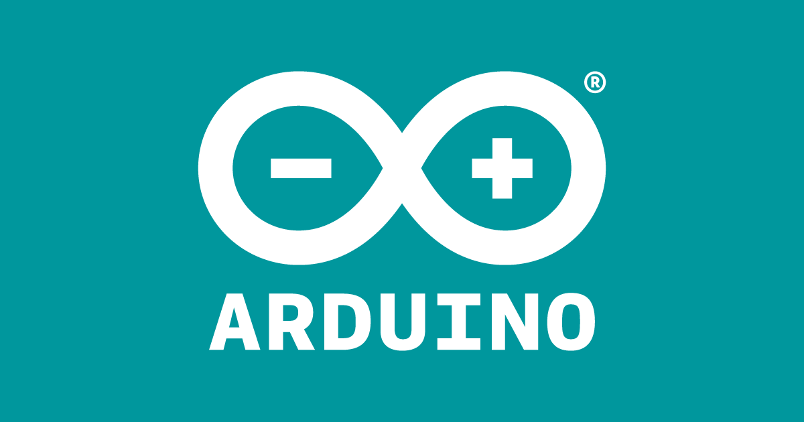
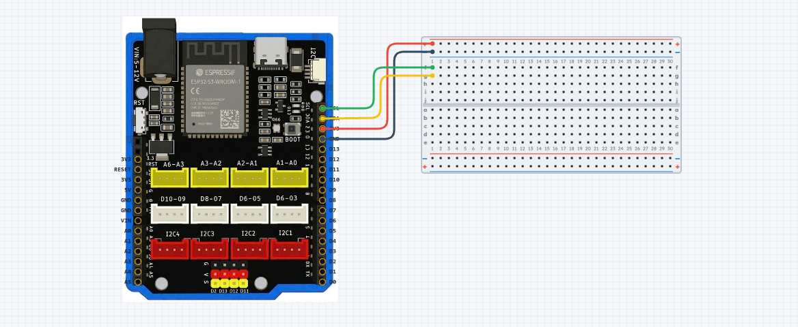

# yolo-uno


Collection of student programs for the Yolo Uno in the [Arduino Advance Kit](https://ohstem.vn/san-pham/bo-cong-cu-phat-trien-cac-ung-dung-dua-tren-vi-dieu-khien/) from the [ohstem](https://ohstem.vn/) company.

## Hardware

The newest versions have an ESP32-S3 with 8 MByte of PSRAM and 16 MiB Flash (ROM). See `import board_info` (from [hardware/board_info.py](hardware/board_info.py)).


### Pinout


You can design your own circuits on [https://app.ohstem.vn/#!/vr](https://app.ohstem.vn/#!/vr)


## Software


### Micropython and Scratch

The standard interface used by OhStem is a Scratch interface to upload the program as MicroPython to the board over USB from the browser. The website is [app.ohstem.vn](https://app.ohstem.vn/)

You can reflash a newer firmware on [https://fw.ohstem.vn/](https://fw.ohstem.vn/)

Online editor for MicroPython with filesystem (alternative to [Thonny](https://thonny.org/) is [https://ma7moud3ly.github.io/micro-repl/](https://ma7moud3ly.github.io/micro-repl/).



### Arduino

You can also programm the Yolo UNO in Arduino C, but you need to import he correct board description:

```
https://raw.githubusercontent.com/AITT-VN/ohstem_arduino_board/main/package_xcon_index.json
```

More documentation:

- [Hướng Dẫn Cài Đặt Arduino và Yolo UNO](https://docs.ohstem.vn/en/latest/yolo_uno/arduino_yolo_uno/cai_dat.html)
- [Related Github repository](https://github.com/AITT-VN/ohstem_arduino_board)


### CircuitPython

Given the 8 MB PSRAM and 16 MB Flash we can try the [YD-ESP32-S3 N16R8 by VCC-GND Studio](https://circuitpython.org/board/yd_esp32_s3_n16r8/) and it works! The NEOPIXEL is at GPIO45, not GPIO48, but hopefully we soon have a native build for this - see ticket [#3 at AITT-VN ohstem_arduino_board](https://github.com/AITT-VN/ohstem_arduino_board/issues/3).



### Thonny with Micropython

Once you have the right port, you can write Micropython programs directly on the Yolo UNO, upload and test them.


## Example programs by OhStem.vm

### [1. Chức năng cơ bản](./1%20Chức%20năng%20cơ%20bản/)

- Bật tắt đèn led onboard
- Đổi màu đèn led RGB onboard
- Nút nhấn onboard

### [2. Làm việc với module](./2%20Làm%20việc%20với%20module/)

- Đèn thông minh
- [Màn hình LCD1602](./2%20Làm%20việc%20với%20module/Màn%20hình%20LCD1602/)
- Giám sát nhiệt độ phòng
- Quạt thông minh
- Động cơ Servo

### [3. Dự án IoT](./3%20Dự%20án%20IoT/)

- Nhận và gửi thông tin lên server

### [4. Dự án AI](./4%20Dự%20án%20AI/)

- Nhận diện hình ảnh bằng OhStem App
- Nhận diện hình ảnh bằng Camera AI

### [5. Robot ảo](./5%20Robot%20ảo/)

- Robot 2 động cơ
- Robot 4 bánh mecanum

The [Editor](https://app.ohstem.vn/) actually saves your programs for you. Address is [app.ohstem.vn](https://app.ohstem.vn/)

## Blink

On pin D13 is a green LED connected. You can use it for feedback or indicate a stats. We just let it blink. The block code looks like this:

<!--  -->


And in Python looks like this:

```py
from pins import *
from yolo_uno import *

pump_D13 = Pins(D13_PIN)

async def setup():

  print('App started')
  for count in range(10):
    pump_D13.write_digital(1)
    await asleep_ms(1000)
    pump_D13.write_digital(0)
    await asleep_ms(1000)

async def main():
  await setup()
  while True:
    await asleep_ms(100)

run_loop(main())
```

## Hardware kits

OhStem has several kits on their website, but no price. Here are some vendors I found:

- Just the Yolo UNO computer with ESP32-S3 - 446.200 VND  - [Giải Pháp Chung](https://giaiphapchung.vn/products/yolo-uno-mach-arduino-lap-trinh-iot-va-ai) as Yolo UNO – Mạch Arduino lập trình IoT và AI - STEM
- Bộ kít làm dự án với Yolo UNO – lập trình IoT và AI - STEM - 1.197.950 VND - [Giải Pháp Chung](https://giaiphapchung.vn/bo-kit-lam-du-an-voi-yolo-uno-lap-trinh-iot-va-ai)
- Bộ Kit học lập trình AI và IoT - AIoT Kit - STEM - 2.017.600 VND [Giải Pháp Chung](https://giaiphapchung.vn/products/bo-kit-hoc-lap-trinh-ai-va-iot-aiot-kit) - but with YoloBit
- Bộ công cụ phát triển ứng dụng dựa trên vi điều khiển - no price available - [Info at ohstem](https://ohstem.vn/san-pham/bo-cong-cu-phat-trien-ung-dung-dua-tren-vi-dieu-khien/)

### ORC - Open Robotics Challenge

- ORC Junior - robot Rover
- ORC Explorer - ORC K2 [Info at ohstem](https://ohstem.vn/san-pham/robot-orc-k2-starter-kit/)
- ORC Master - ORC K3 [Info at ohstem](https://ohstem.vn/san-pham/robot-orc-k3-starter-kit/)


