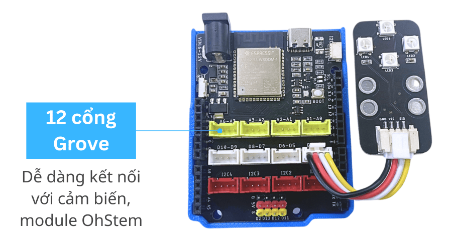
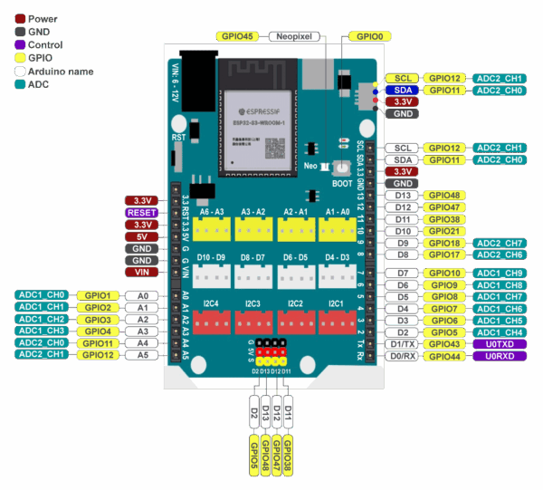

# yolo-uno


Collection of student programs for the Yolo Uno in the [Arduino Advance Kit](https://ohstem.vn/san-pham/bo-cong-cu-phat-trien-cac-ung-dung-dua-tren-vi-dieu-khien/) from the [ohstem](https://ohstem.vn/) company.

## Hardware

The newest versions have an ESP32-S3 with 8 MByte of PSRAM and 16 MiB Flash (ROM). See `import board_info` (from [hardware/board_info.py](hardware/board_info.py)).



### Pinout



You can design your own circuits on [https://app.ohstem.vn/#!/vr](https://app.ohstem.vn/#!/vr)

## Software

### Micropython and Scratch

The standard interface used by OhStem is a Scratch interface to upload the program as MicroPython to the board over USB from the browser. The website is [app.ohstem.vn](https://app.ohstem.vn/)

You can reflash a newer firmware on [https://fw.ohstem.vn/](https://fw.ohstem.vn/)

### Arduino

You can also programm the Yolo UNO in Arduino C, but you need to import he correct board description:

```
https://raw.githubusercontent.com/AITT-VN/ohstem_arduino_board/main/package_xcon_index.json
```

More documentation:

- [Hướng Dẫn Cài Đặt Arduino và Yolo UNO](https://docs.ohstem.vn/en/latest/yolo_uno/arduino_yolo_uno/cai_dat.html)
- [Related Github repository](https://github.com/AITT-VN/ohstem_arduino_board)

### CircuitPython

Given the 8 MB PSRAM and 16 MB Flash we can try the [ESP32-S3-DevKitC-1-N8R8](https://circuitpython.org/board/espressif_esp32s3_devkitc_1_n8r8/) even though we have 16 GB of flash. Someone has to write the correct program.

## Example programs by OhStem.vm

### 1. Chức năng cơ bản
- Bật tắt đèn led onboard
- Đổi màu đèn led RGB onboard
- Nút nhấn onboard

### 2. Làm việc với module
- Đèn thông minh
- Màn hình LCD1602
- Giám sát nhiệt độ phòng
- Quạt thông minh
- Động cơ Servo

### 3. Dự án IoT
- Nhận và gửi thông tin lên server

### 4. Dự án AI
- Nhận diện hình ảnh bằng OhStem App
- Nhận diện hình ảnh bằng Camera AI

### 5. Robot ảo
- Robot 2 động cơ
- Robot 4 bánh mecanum

The [Editor](https://app.ohstem.vn/) actually saves your programs for you. Address is [app.ohstem.vn](https://app.ohstem.vn/)

## Blink

On pin D13 is a green LED connected. You can use it for feedback or indicate a stats. We just let it blink. The block code looks like this:


And in Python looks like this:

```py
from pins import *
from yolo_uno import *

pump_D13 = Pins(D13_PIN)

async def setup():

  print('App started')
  for count in range(10):
    pump_D13.write_digital(1)
    await asleep_ms(1000)
    pump_D13.write_digital(0)
    await asleep_ms(1000)

async def main():
  await setup()
  while True:
    await asleep_ms(100)

run_loop(main())
```

More to follow...
